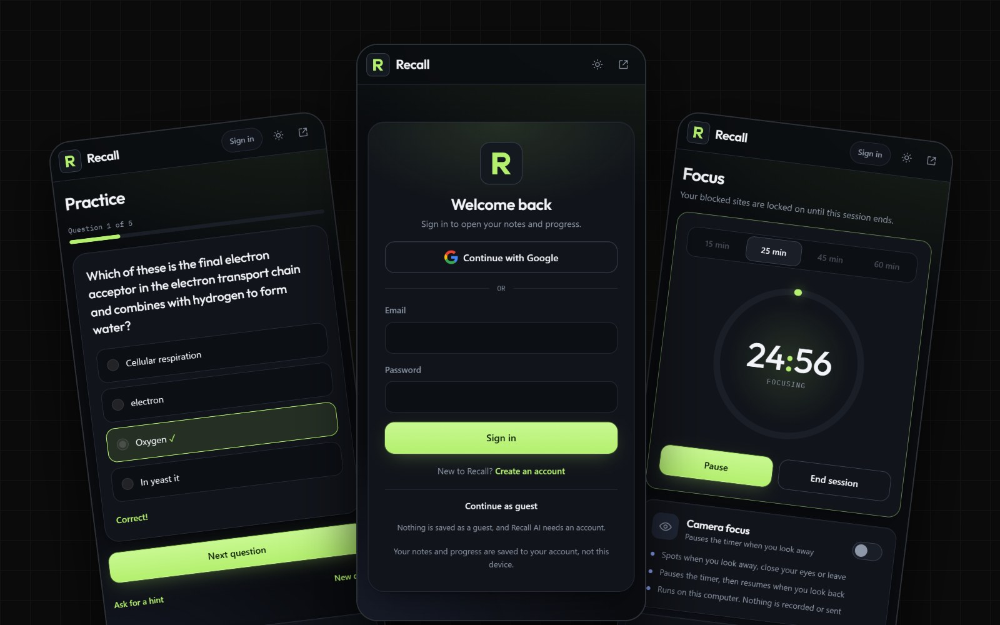
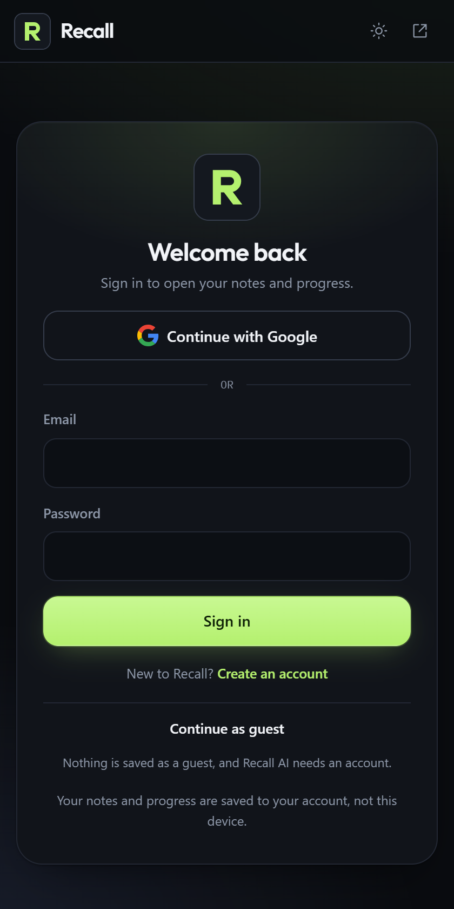
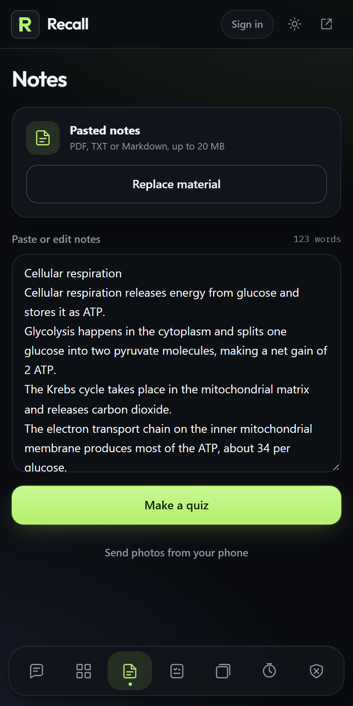
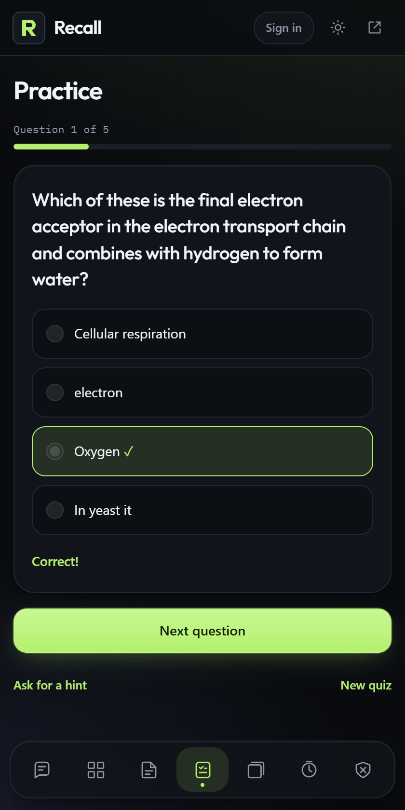
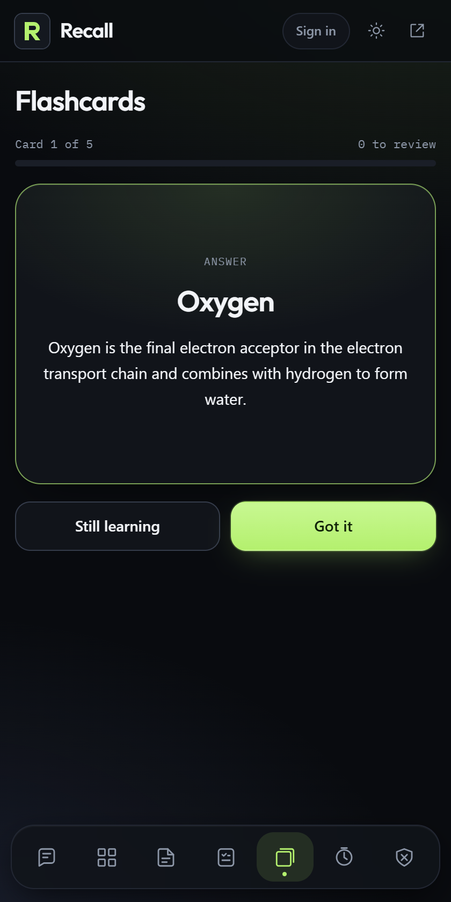
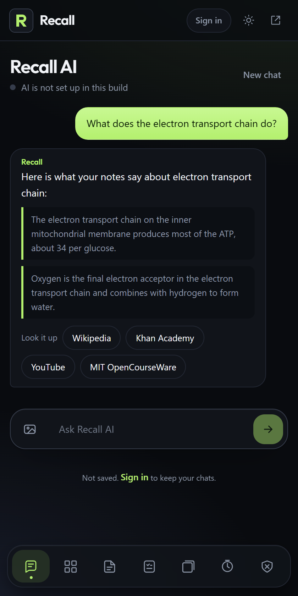
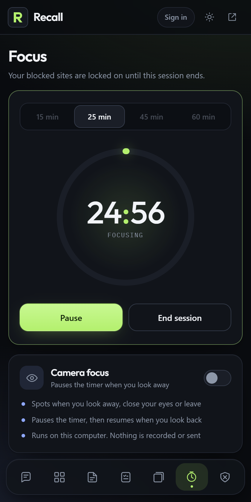
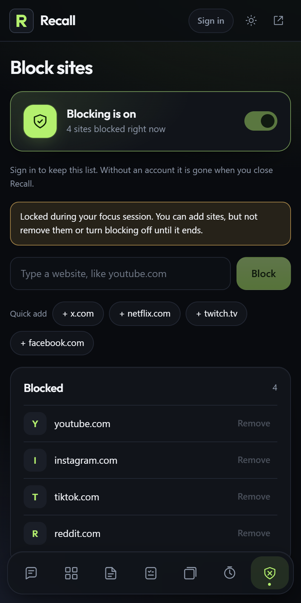
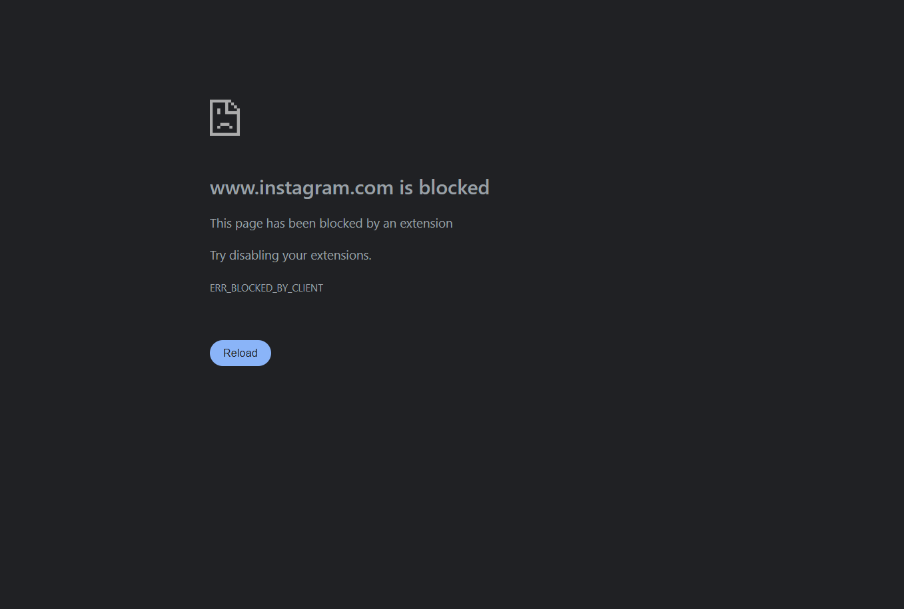

# Recall

A Chrome side-panel study app. It turns your own notes into quizzes, flashcards and practice papers, with an AI tutor that gives hints instead of answers.

**[See the full project write-up and live focus-tracking demo →](https://aidenzhang.vercel.app/#projects/recall-ai-study-assistant-chrome-extension)**



## About

Recall lives in Chrome's side panel, next to whatever you are studying. You paste notes or import a PDF, and Recall turns them into practice: quizzes in 4 formats, flashcards, a new practice paper in the same layout as a past paper, or a problem set of 5 to 20 worked problems. Every answer is marked straight away, only first tries count, and the topics you miss come back first.

Recall AI is a tutor that works from your notes. It answers questions, explains ideas in plain words, reads screenshots you paste in, and shows which lines of your notes it used. During a quiz it switches to hints only: three steps that get closer each time, and any reply that would give the answer away is thrown out.

To help you stay on task, a 15 to 60 minute focus timer locks the site blocker on for the length of the session. An optional webcam check uses MediaPipe Face Landmarker in the browser to tell whether you are looking at the screen, and pauses the timer when you are not.

Everything is saved to your account through Supabase, never to the device. The AI key stays on the server behind a Supabase Edge Function, so it is never inside the extension.

## At a glance

| | |
| --- | --- |
| Study modes | 4 question types (multiple choice, fill in the blank, long answer, mixed), flashcards, practice papers, problem sets |
| Imports | PDF, TXT and Markdown up to 20 MB, read in the browser with pdf.js |
| Recall AI | Groq `gpt-oss-120b` for text, a vision model for pictures (up to 3 per message), 200 requests per user per day |
| Hints | 3 levels per question, and replies that reveal the answer are rejected |
| Focus timer | 15, 25, 45 or 60 minutes, with the site blocker locked on until it ends |
| Camera focus | 478 face landmarks reduced to head yaw, head pitch and blink, giving 4 states. Pauses after 15 s to 2 min away and resumes after 2 s back |
| Site blocker | Up to 100 domains and their subdomains, blocking all 15 request types |
| Security | Row-level security on every table, parameterized SQL, PBKDF2 with 210,000 iterations, lockout after 8 failed sign-ins |
| Tests | 60 Node tests and 36 JUnit tests, run by GitHub Actions on every push |

## Why

Getting an AI answer straight away can feel like understanding without actually testing what you remember. Recall keeps practice, hints and review next to your material, so you still do the thinking.

## How camera focus works

1. MediaPipe Face Landmarker finds 478 points on your face in each webcam frame, all on your computer.
2. Recall turns them into three numbers: head turn (yaw), head tilt (pitch) and an eye-blink score.
3. The first few seconds set your own baseline, so a webcam off to one side still works.
4. A yaw shift over 0.2 or a pitch shift over 0.24 means looking away, and a blink score over 0.6 means eyes closed. No face found means you left.
5. More than 2 seconds away counts as a look-away. At your chosen timeout it chimes and pauses, and 2 seconds back on screen resumes it.
6. The panel shows screen attention (time on screen ÷ time tracked), look-aways, your best streak and a strip of the last minute.

Frames are never saved or sent, and nothing identifies who you are.

## Screens

<table>
  <tr>
    <td align="center" width="25%"><br><sub>Sign in or continue as a guest</sub></td>
    <td align="center" width="25%"><br><sub>Paste notes or import PDFs</sub></td>
    <td align="center" width="25%"><br><sub>Quizzes marked as you go</sub></td>
    <td align="center" width="25%"><br><sub>Flashcards</sub></td>
  </tr>
  <tr>
    <td align="center"><br><sub>AI chat grounded in your notes</sub></td>
    <td align="center"><br><sub>Focus timer with camera check</sub></td>
    <td align="center"><br><sub>Site blocker, locked during focus</sub></td>
    <td align="center"><br><sub>A blocked site in Chrome</sub></td>
  </tr>
</table>

## Features

- **Notes and PDFs.** Paste notes or import TXT, Markdown or PDF files, read in the browser.
- **Recall AI.** Chat about your notes and paste screenshots with Ctrl+V. On quiz questions it gives three hints and never the answer.
- **Practice.** Multiple choice, fill in the blank, long answer or mixed. Missed topics come back first.
- **Practice papers and problem sets.** A new paper in the same format as an uploaded past paper, or worked problems on any topic, as PDFs.
- **Focus timer and camera focus.** The webcam check pauses the timer when you look away and resumes it when you look back.
- **Site blocker.** Blocks distracting domains and locks on during a focus session.
- **Accounts or guest mode.** Google or email sign-in. Guests get everything except Recall AI, and nothing is saved.

## Tech stack

| Part | Built with |
| --- | --- |
| Extension | React 19, TypeScript, Vite, Chrome Manifest V3 |
| AI | Supabase Edge Function (Deno) calling Groq (`gpt-oss-120b`, plus a vision model for pictures) |
| Accounts and data | Supabase Auth (email and Google via a Google Cloud OAuth client), PostgreSQL |
| Camera focus | MediaPipe Face Landmarker, running in the browser |
| PDFs | pdf.js to read, jsPDF to write |
| Optional backend | Java 21, Spring Boot, JDBC, HikariCP, PostgreSQL |
| Tests and CI | node:test, JUnit, ESLint, GitHub Actions |

## Security

- **No AI key in the extension.** It lives in Supabase. Each signed-in user gets a daily limit (200 by default).
- **Row-level security.** Every user can only read and write their own data.
- **Parameterized SQL.** All backend queries use JDBC placeholders, so input is never pasted into SQL.
- **Passwords** are hashed with salted PBKDF2-HMAC-SHA256 (210,000 iterations), and sign-in locks after 8 failed tries.
- **Camera frames** stay in memory on your computer and are never saved or sent.

## Quick start

Install Node.js 24, then from the repository root:

```powershell
npm ci --prefix extension
npm run build --prefix extension
```

Open `chrome://extensions`, turn on **Developer mode**, click **Load unpacked** and choose `extension/dist`. Click Recall's toolbar icon to open it.

Connecting Supabase for accounts and Recall AI, plus the optional backend, Google sign-in, hosting and the full privacy notes, are in **[docs/setup.md](docs/setup.md)**.

## Notes

Recall is a student project, provided as is. It doesn't train any models: the language models and Face Landmarker are pretrained, and the camera check uses hand-written thresholds. AI answers and generated questions can be wrong, so check them against your notes.
